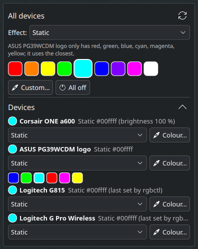

# plasma-rgb-control

Control RGB lighting from KDE Plasma: a Plasma 6 widget (`plasmoid/`), a CLI (`rgbctl.py`) and pluggable device drivers (`rgbdevices/`). New devices are added by dropping a driver file in `~/.config/rgbctl/devices/`, see [docs/writing-a-driver.md](docs/writing-a-driver.md).



## Install

```bash
./install.sh
systemctl --user restart plasma-plasmashell
```

`install.sh` links the CLI to `~/.local/bin/rgbctl`, installs the systemd user service `rgbctl-restore@.service` (see [Reconnects](#reconnects-kvm-switch-replug)) and installs or updates the widget. Add the widget via right-click on the desktop or panel → *Add Widgets…* → **RGB Lighting**.

## Built-in drivers

| Device | id | How | Effects | Colours |
|---|---|---|---|---|
| Corsair ONE a600 front strips | `corsair` | USB HID `1b1c:0d18` via `rgbdevices/a600hw.py` (copied from the corsair-one-a600-linux project) | off, static, breathing, strobing, color_cycle, rainbow, starry_night | any (static only) |
| ASUS PG39WCDM rear logo (OSD "Aura RGB") | `asus` | DDC/CI VCP `F2` via `ddcutil --model PG39WCDM` | off, static, breathing, strobing, color_cycle, rainbow | red, green, blue, cyan, magenta, yellow (nearest by hue) |
| Logitech G815 keyboard (keys + logo) | `g815` | HID++ 2.0 feature 0x8071 on `046d:c33f` interface 1 | off, static, breathing, color_cycle, wave, ripple (logo: wave → cycle, ripple → static) | any |
| Logitech G Pro Wireless (both zones) | `gpro` | HID++ 2.0 feature 0x8070 via receiver `046d:c53a` interface 2, slot 1 | off, static, breathing, color_cycle | any |

Protocol notes for the Corsair controller: `docs/corsair-a600-protocol.md`.

Logitech devices have no read-back of the active effect; status shows the last setting rgbctl sent (`~/.cache/rgbctl/state.json`). `tools/logitech_probe.py` lists their lighting features, zones and effects (read-only).

### Device access

The Corsair and Logitech devices are USB HID devices; udev rules give the logged-in desktop user access to their lighting interfaces. Install the ones for your devices (once):

```bash
sudo install -m 644 deploy/70-rgbctl-corsair.rules deploy/70-rgbctl-logitech.rules /etc/udev/rules.d/
sudo udevadm control --reload && sudo udevadm trigger --subsystem-match=hidraw
```

| Rule | Device |
|---|---|
| `70-rgbctl-corsair.rules` | Corsair ONE a600 lighting controller `1b1c:0d18`, interface 2 |
| `70-rgbctl-logitech.rules` | Logitech G815 `046d:c33f` and the Lightspeed receiver `046d:c53a` (G Pro Wireless) |

### Reconnects (KVM switch, replug)

The G815 falls back to its onboard effect whenever it loses power, e.g. on a KVM switch; the receiver of the G Pro reconnects at the same time. `deploy/71-rgbctl-restore.rules` starts `rgbctl-restore@<id>.service` for the logged-in user when the device comes back, which runs `rgbctl restore <id> --wait 30`: it sets the last known state again, retrying while the device is still starting up.

```bash
sudo install -m 644 deploy/71-rgbctl-restore.rules /etc/udev/rules.d/
sudo udevadm control --reload
```

`journalctl --user -u 'rgbctl-restore@*'` shows what it did. To use it for another device, add a line with `TAG+="systemd", ENV{SYSTEMD_USER_WANTS}+="rgbctl-restore@<id>.service"` for that device's node.

The Corsair rule is independent of the corsair-one-a600 CoolerControl plugin: that plugin only handles cooling, and its own rule (which its uninstaller removes) only covers the cooling controller. The ASUS monitor needs `ddcutil` with access to `/dev/i2c-*` (usually the `i2c` group).

## Global effects

Effects every device can show, used by `set all` and the widget's *All devices* effect menu (`rgbctl.py effects` prints the mapping):

| Global | Corsair | ASUS | G815 | G Pro |
|---|---|---|---|---|
| off | off | off | off | off |
| static (colour) | static | static (nearest preset) | static | static |
| breathing (colour) | breathing (own colours) | breathing | breathing | breathing |
| color_cycle | color_cycle | color_cycle | color_cycle | color_cycle |
| rainbow | rainbow | rainbow | wave | color_cycle |

Device-only effects (strobing, ripple, starry night) are set per device. With `set all <effect>`, a device that has nothing similar is skipped. A device's `equivalents` dict maps a global effect to its own one.

## CLI

```bash
./rgbctl.py status
./rgbctl.py set all static '#ff8000'
./rgbctl.py set asus breathing blue
./rgbctl.py set corsair rainbow
./rgbctl.py set all off
./rgbctl.py restore            # set the last known state again (all devices, or one id)
./rgbctl.py list
```

Add `--json` for machine-readable output (used by the widget). Calls are serialised with a lock in `$XDG_RUNTIME_DIR/rgbctl.lock`.

Optional config `~/.config/rgbctl/config.json`:

```json
{"disabled": [], "corsair": {"brightness": 100}, "asus": {"model": "PG39WCDM"}}
```

## Widget

Installed by `install.sh`. It runs `rgbctl` from PATH or `~/.local/bin`; to use another copy, set the path in the widget settings (right-click → *Configure RGB Lighting…*). The *Devices* section can be collapsed; on the desktop the widget's background shrinks with it. Hints under the effect list (devices that show an effect differently, use their own colours or only have fixed colours) come from the driver data.

## Safety notes

- **ASUS:** never write F2 effect index `1` (turns Aura Sync on, darkens the logo and locks the OSD until a factory reset) or values above 6. `encode_write()` refuses them; writes are at least 1 s apart and verified by decoding the read-back. ddcutil's "Verification failed" is expected. The stand light (LIGHT IN MOTION) can't be controlled.
- **Corsair:** the lighting controller remembers the last effect across reboots. The corsair-one-a600 CoolerControl plugin (0.3.0 and later) only controls cooling and doesn't touch the lighting.
- **G815:** runs its onboard profile (0x8100 onboard mode) and ignores lighting commands until software control is claimed (0x8071 function 5, `01 03 05`). rgbctl sends the claim before every change; the onboard profile itself (G-keys etc.) stays active. After a power cycle the keyboard shows its profile lighting again until rgbctl sets something.

## Adding a device

Write a driver: a Python file with a `Device` subclass and `DEVICES = {"<id>": Class}`. Put it in `~/.config/rgbctl/devices/` (your own devices) or `rgbdevices/` (to contribute it here); it is found automatically, and the CLI, `set all` and the widget pick it up. A driver that fails to load shows as an error without affecting the others. [docs/writing-a-driver.md](docs/writing-a-driver.md) describes the interface; [examples/demo_device.py](examples/demo_device.py) is a working driver that needs no hardware.

Config keys for drivers: `disabled` (ids to skip), `order` (ids in display order), `driver_dirs` (extra driver folders), `builtin_drivers` (`false` to load only your own), and one section per device id for its options.

Tests: `python3 -m unittest discover -s tests`.

## Licence

GPL-3.0-or-later, see [LICENSE](LICENSE). `rgbdevices/a600hw.py` comes from the corsair-one-a600-linux project under the same licence.
